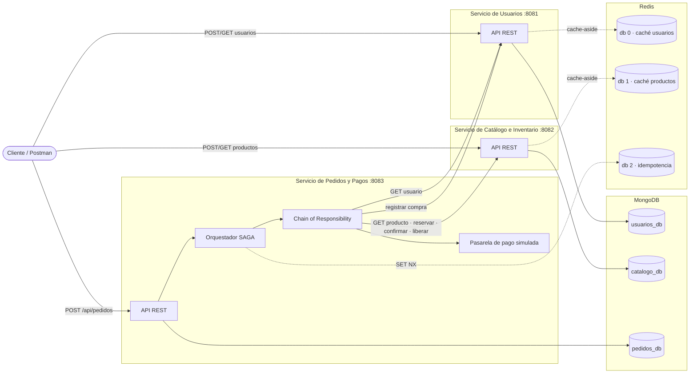
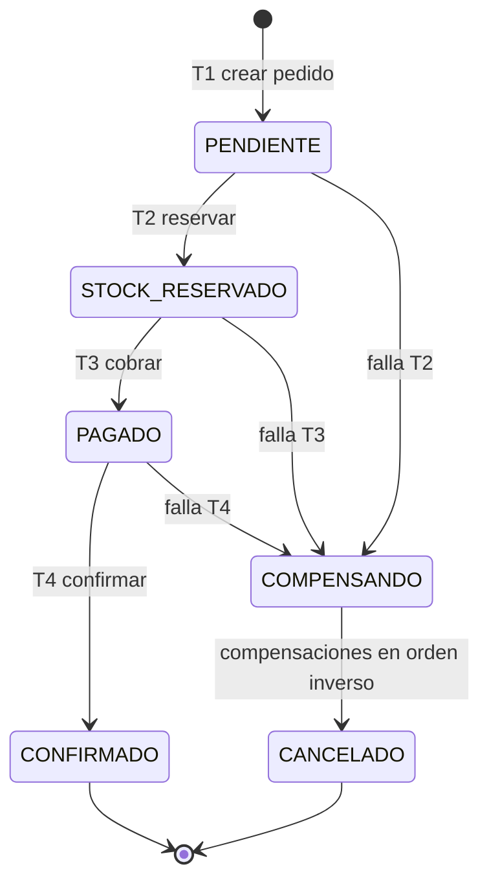
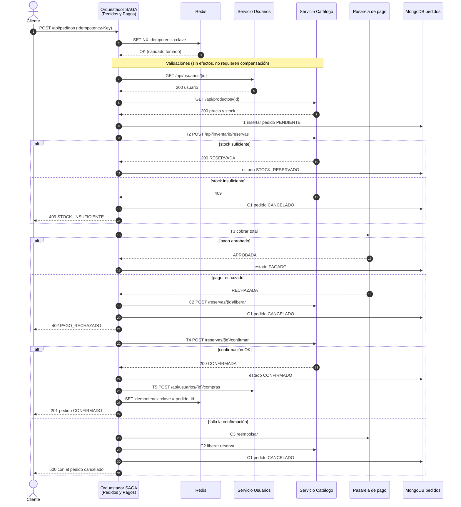
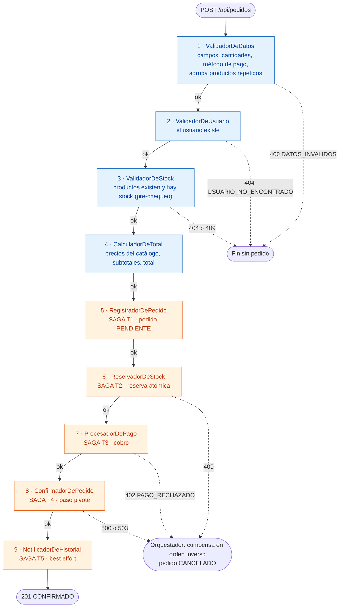

# ShopExpress — Sistema de microservicios para comercio electrónico

**Tarea 2 – 2026 · Programa de Educación Terciaria CETP-UTU**

Implementación de tres microservicios en **Spring Boot 3 (Java 21)** con persistencia políglota en **MongoDB** y **Redis**, orquestación de transacciones distribuidas con el **patrón SAGA**, lógica de negocio estructurada con **Chain of Responsibility** y despliegue con **Docker Compose**.

| Servicio | Puerto | Responsabilidad | Persistencia |
|---|---|---|---|
| `usuarios-service` | 8081 | Perfiles, direcciones, historial de compras | MongoDB `usuarios_db` + Redis (caché, db 0) |
| `catalogo-service` | 8082 | Productos, categorías, precios y stock | MongoDB `catalogo_db` + Redis (caché, db 1) |
| `pedidos-service` | 8083 | Pedidos, pagos, orquestador SAGA | MongoDB `pedidos_db` + Redis (idempotencia, db 2) |

---

## Índice

1. [Cómo ejecutar](#1-cómo-ejecutar)
2. [Diagrama de arquitectura](#2-diagrama-de-arquitectura)
3. [Justificación del diseño](#3-justificación-del-diseño)
4. [Patrón SAGA (orquestación)](#4-patrón-saga-orquestación)
5. [Patrón Chain of Responsibility](#5-patrón-chain-of-responsibility)
6. [Patrones avanzados y privacidad](#6-patrones-avanzados-y-privacidad)
7. [Referencia de endpoints](#7-referencia-de-endpoints)
8. [Estructura del repositorio](#8-estructura-del-repositorio)
9. [Limitaciones conocidas](#9-limitaciones-conocidas)

---

## 1. Cómo ejecutar

### Requisitos

- Docker y Docker Compose v2.
- No hace falta instalar Java ni Maven: cada imagen compila su servicio en una etapa de build (Dockerfile multi-stage).
- Para las pruebas: Postman, o Node.js para correr la colección con `newman`.

### Construir y levantar

```bash
docker compose up --build -d
```

La primera vez tarda unos minutos porque Maven descarga dependencias dentro de las imágenes. Para seguir los logs:

```bash
docker compose logs -f pedidos-service
```

Verificar que los servicios estén arriba:

```bash
curl http://localhost:8081/actuator/health
curl http://localhost:8082/actuator/health
curl http://localhost:8083/actuator/health
```

### Datos semilla

Al arrancar se cargan datos de ejemplo (se puede desactivar con `SEED_DATA=false`):

| ID | Descripción |
|---|---|
| `usr_12345` | Juan Pérez (el usuario del anexo de la letra) |
| `prod_001` | Auriculares Bluetooth · $25.50 · stock 100 |
| `prod_002` | Teclado mecánico · $89.90 · stock 3 |
| `prod_003` | Monitor 27" · $349.00 · stock 0 |

### Probar

**Colección Postman** (`postman/ShopExpress.postman_collection.json`): importarla y ejecutarla completa con el *Collection Runner*. Las peticiones están ordenadas y encadenan variables (crean un usuario, dos productos, y recorren el camino feliz y todos los casos de falla con sus aserciones).

Por línea de comandos:

```bash
npx newman run postman/ShopExpress.postman_collection.json
```

**Prueba de sobreventa concurrente**: crea un producto con 5 unidades y lanza 20 pedidos en paralelo. Debe confirmar exactamente 5 y dejar el stock en 0.

```bash
./scripts/prueba-sobreventa.sh          # 5 unidades, 20 pedidos
./scripts/prueba-sobreventa.sh 10 50    # 10 unidades, 50 pedidos
```

(En Windows, ejecutarlo desde Git Bash o WSL.)

**Pruebas unitarias** (requiere Java 21 y Maven locales; opcional):

```bash
cd pedidos-service && mvn test
```

**Ejemplo rápido con curl**:

```bash
curl -X POST http://localhost:8083/api/pedidos \
  -H "Content-Type: application/json" \
  -H "Idempotency-Key: demo-001" \
  -d '{
        "usuario_id": "usr_12345",
        "items": [{ "producto_id": "prod_001", "cantidad": 2 }],
        "pago": { "metodo": "TARJETA_CREDITO", "token_tarjeta": "tok_visa_ok" }
      }'
```

### Escenarios para la demo

| Escenario | Cómo provocarlo | Resultado |
|---|---|---|
| Camino feliz | Pedido normal | `201`, pedido `CONFIRMADO` |
| Sin stock | `prod_003` o cantidad mayor al stock | `409 STOCK_INSUFICIENTE`, no se crea pedido |
| Pago rechazado | `"token_tarjeta": "tok_rechazada"` | `402`, se libera la reserva, pedido `CANCELADO` |
| Monto excedido | Total mayor a $5000 (p. ej. 15 monitores tras reponer stock) | `402`, compensación |
| Fallo después del cobro | Cabecera `X-Simular-Fallo: CONFIRMACION` | `500`, reembolso + liberación, pedido `CANCELADO` |
| Reintento del cliente | Repetir con la misma `Idempotency-Key` | `200` con el mismo pedido, sin cobrar dos veces |
| Concurrencia | `scripts/prueba-sobreventa.sh` | Nunca se vende más del stock |

### Detener

```bash
docker compose down        # conserva los datos
docker compose down -v     # borra también los volúmenes de MongoDB y Redis
```

---

## 2. Diagrama de arquitectura



- Cada servicio es dueño de **su propia base de datos** (*database per service*): ningún servicio lee la base de otro, solo se comunican por HTTP.
- La comunicación es **síncrona (REST)** y siempre parte del orquestador. Los servicios de Usuarios y Catálogo no conocen la SAGA.
- Por simplicidad del entorno de la tarea se usa **una instancia** de MongoDB con tres bases lógicas y **una instancia** de Redis con tres bases numeradas. En producción cada servicio tendría su propio clúster.

---

## 3. Justificación del diseño

### 3.1 Requerimientos de consistencia: dos lados del teorema CAP

La letra pide dos comportamientos opuestos, así que el sistema no elige un único punto del teorema CAP: **cada flujo elige el suyo**.

| Flujo | Prioridad | Cómo se implementa |
|---|---|---|
| **Lectura** de catálogo y usuarios | **AP**: disponibilidad + tolerancia a particiones, consistencia eventual | Caché *cache-aside* en Redis con TTL (30 s productos, 60 s usuarios). Si Redis falla, el servicio **sigue respondiendo** desde MongoDB (se registra una advertencia en vez de devolver error). Cada escritura invalida la entrada, así que el atraso real suele ser nulo y como máximo es el TTL. |
| **Escritura** de pedidos y pagos | **CP**: consistencia sobre velocidad | El stock se descuenta con una **actualización condicional atómica** en MongoDB (ver abajo), con `writeConcern: majority`. El pedido es único por `_id` y por `idempotency_key`. Si un servicio necesario no responde, el pedido **se rechaza** (y se compensa) en lugar de quedar a medias. |

**Por qué no hay sobreventa.** MongoDB garantiza atomicidad a nivel de documento. Por eso el stock vive dentro del documento del producto y la reserva es una única operación que combina chequeo y descuento:

```js
db.productos.updateOne(
  { _id: "prod_001", stock_disponible: { $gte: 2 } },     // condición
  { $inc: { stock_disponible: -2, stock_reservado: 2 } }  // descuento
)
```

Si dos pedidos compiten por la última unidad, el motor serializa las dos operaciones sobre el documento: la primera cumple el filtro y descuenta; la segunda ya no encuentra un documento con `stock_disponible >= 1` y no modifica nada (`modifiedCount = 0`). No hay ventana entre "leer" y "escribir" porque no hay lectura previa. Un pedido con varios productos descuenta ítem por ítem; si uno falla, el servicio revierte los ya descontados antes de responder (todo o nada).

**El stock que se muestra no es el que decide.** `GET /api/productos/{id}` puede devolver un stock con unos segundos de atraso (lado AP). Eso es aceptable porque la decisión de vender se toma siempre en la reserva atómica contra MongoDB (lado CP). El `ValidadorDeStock` de la cadena usa la lectura rápida solo para rechazar temprano los casos obvios.

**Unicidad del pedido.** Se garantiza en tres niveles:

1. `pedido_id` generado por el servidor (`ord_` + UUID) y usado como `_id`.
2. Cabecera opcional `Idempotency-Key`: Redis toma un candado con `SET NX` (atómico) y después guarda `clave → pedido_id` por 24 h. Repetir la solicitud devuelve el mismo pedido, sin volver a reservar ni a cobrar.
3. Índice único en MongoDB sobre `idempotency_key`: si Redis no estuviera disponible, sigue siendo imposible crear dos pedidos con la misma clave. Redis acelera; MongoDB garantiza.

### 3.2 Bases de datos elegidas

**MongoDB (documental)** como base principal de los tres servicios:

- Los datos del dominio son **agregados naturales** (un usuario con sus direcciones, un pedido con sus ítems y su pago) que se leen y escriben juntos; el modelo documental los guarda en una sola unidad, como en el anexo de la letra.
- **Esquema flexible**: los productos tienen `atributos` distintos según la categoría (color, talle, voltaje) sin migraciones.
- **Atomicidad por documento y actualizaciones condicionales** (`$inc` con filtro, `findAndModify`), que son la base de la garantía anti-sobreventa.
- **Índices únicos** (email, documento, SKU, idempotency key) y `writeConcern: majority` para las escrituras críticas.
- Escala horizontalmente con *sharding* (por ejemplo, productos por `_id`, pedidos por `usuario_id`).

**Redis (clave-valor en memoria)** como complemento:

- **Latencia sub-milisegundo** para las lecturas de catálogo y usuarios.
- **TTL nativo**: la expiración de la caché y de las claves de idempotencia no requiere tareas de limpieza.
- **`SET NX` atómico**: un candado distribuido simple para la idempotencia.
- Persistencia AOF activada en Docker Compose para que las claves de idempotencia sobrevivan a un reinicio.

Se descartó usar Redis como fuente de verdad del stock (aunque sus scripts Lua permitirían descontar varios productos de forma atómica) porque el stock es un dato de negocio crítico y se prefirió la durabilidad de MongoDB con `majority`.

### 3.3 Modelado de datos: embebido vs. referencia

**Usuario** (`usuarios_db.usuarios`)

```json
{
  "_id": "usr_12345",
  "tipo_documento": "DNI",
  "nro_documento_cifrado": "q8Zt...==",
  "documento_hash": "9f3c...e1",
  "nombre": "Juan",
  "apellido": "Pérez",
  "email": "juan.perez@example.com",
  "direcciones": [
    { "calle": "Av. Principal 123", "ciudad": "Montevideo", "codigo_postal": "11000" }
  ],
  "historial_compras": [
    { "pedido_id": "ord_8c1f...", "fecha": "2026-11-05T13:00:00Z", "total": 51.00, "cantidad_items": 2 }
  ],
  "fecha_alta": "2026-10-18T22:00:00Z"
}
```

| Relación | Patrón | Motivo |
|---|---|---|
| Usuario → direcciones | **Embebido** | Relación 1 a pocos, siempre se leen con el usuario y no tienen sentido por separado. |
| Usuario → historial de compras | **Referencia extendida** | Se guarda `pedido_id` (referencia al Servicio de Pedidos, dueño del dato) más un resumen mínimo para listar el historial sin otra llamada. No se embebe el pedido completo: no se duplica información de otro servicio y el documento no crece sin control. |

**Producto** (`catalogo_db.productos`)

```json
{
  "_id": "prod_001",
  "sku": "AUR-BT-001",
  "nombre": "Auriculares Bluetooth",
  "categoria": { "codigo": "AUDIO", "nombre": "Audio" },
  "precio": "25.50",
  "stock_disponible": 98,
  "stock_reservado": 0,
  "atributos": { "color": "negro", "autonomia": "30h" }
}
```

| Relación | Patrón | Motivo |
|---|---|---|
| Producto → categoría | **Embebido** (desnormalizado) | Se muestra en cada consulta y casi nunca cambia; embeberla evita un segundo acceso en el camino de lectura más frecuente. |
| Producto → stock | **En el mismo documento** | Requisito de la atomicidad: chequeo y descuento en una sola operación. `stock_reservado` separa las unidades apartadas por SAGAs en curso de las vendidas. |
| Reserva → productos | **Referencia** (`producto_id`) | Colección `reservas` aparte, con `_id = pedido_id`. La clave primaria impide reservar dos veces para el mismo pedido. |

**Pedido** (`pedidos_db.pedidos`)

| Relación | Patrón | Motivo |
|---|---|---|
| Pedido → ítems y pago | **Embebido** | Igual que en el anexo. Se crean y consultan juntos; el tamaño está acotado (máximo 20 productos). |
| Ítem → producto | **Referencia + copia** | `producto_id` referencia al catálogo, pero `nombre` y `precio_unitario` se copian como **foto del momento de la compra**: si mañana cambia el precio, el pedido histórico no cambia. |
| Pedido → usuario | **Referencia** (`usuario_id`) | El usuario pertenece a otro servicio. |
| Pedido → bitácora SAGA | **Embebido** (`pasos_saga`) | Trazabilidad de cada paso y compensación (ver sección 6). |

> Los campos `precio` y `total` se manejan como `BigDecimal` en Java (nunca `double`, para no tener errores de redondeo con dinero). Spring Data los persiste como texto decimal exacto.

---

## 4. Patrón SAGA (orquestación)

Crear un pedido toca tres servicios y no existe una transacción ACID que los abarque. La SAGA divide la operación en **transacciones locales**, cada una con su **transacción de compensación**. Se eligió **orquestación**: `OrquestadorSagaPedidos`, dentro del Servicio de Pedidos y Pagos, decide el orden, conoce el estado y dispara las compensaciones. Los otros servicios solo exponen operaciones; no saben que participan en una SAGA.

### Pasos y compensaciones

| # | Transacción (Tᵢ) | Servicio | Compensación (Cᵢ) |
|---|---|---|---|
| T1 | Crear pedido `PENDIENTE` | Pedidos | C1: marcar `CANCELADO` (no se borra, queda el rastro) |
| T2 | Reservar stock (atómico, por `pedido_id`) | Catálogo | C2: liberar reserva (devuelve unidades) |
| T3 | Cobrar | Pedidos (pasarela) | C3: reembolsar |
| T4 | Confirmar reserva y pedido `CONFIRMADO` | Catálogo + Pedidos | **Paso pivote**: a partir de aquí la SAGA ya no se revierte |
| T5 | Registrar en historial del usuario | Usuarios | Sin compensación: es *best effort*; si falla queda `PENDIENTE_REINTENTO` y la venta sigue confirmada |

Antes de T1 la cadena ejecuta validaciones que **no modifican nada** (datos, usuario, stock, total), así que un fallo ahí no requiere compensar y no deja ningún pedido creado.

### Estados del pedido



### Diagrama de flujo de la SAGA



### Decisiones de robustez

- **Compensaciones en orden inverso (LIFO).** Cada paso compensable se apila en el contexto; ante un fallo se desapilan. Si una compensación falla, se registra como `ERROR_COMPENSACION` y **se siguen ejecutando las demás**.
- **Se registra la compensación antes de ejecutar el paso.** Si la llamada a otro servicio vence por *timeout*, no se sabe si el cambio se aplicó. Como el paso ya está en la pila, su compensación se intenta igual.
- **Todo es idempotente por `pedido_id`.** Reservar dos veces devuelve la misma reserva; liberar algo ya liberado o inexistente no hace nada; cobrar dos veces devuelve la misma transacción; reembolsar solo actúa sobre un cobro `APROBADO` (transición atómica). Esto permite reintentar cualquier paso o compensación sin efectos duplicados.
- **Timeouts** de conexión (2 s) y lectura (5 s) en las llamadas HTTP: una dependencia lenta no bloquea la SAGA indefinidamente.
- **Estado persistido en cada transición** con la bitácora `pasos_saga`: si el proceso se cae a mitad, el pedido muestra exactamente dónde quedó.

Ejemplo de bitácora de un pedido que falló después del cobro:

```json
"pasos_saga": [
  { "paso": "VALIDAR_DATOS",            "resultado": "OK" },
  { "paso": "VALIDAR_USUARIO",          "resultado": "OK" },
  { "paso": "VALIDAR_STOCK",            "resultado": "OK" },
  { "paso": "CALCULAR_TOTAL",           "resultado": "OK" },
  { "paso": "CREAR_PEDIDO",             "resultado": "OK" },
  { "paso": "RESERVAR_STOCK",           "resultado": "OK" },
  { "paso": "PROCESAR_PAGO",            "resultado": "OK" },
  { "paso": "CONFIRMAR_PEDIDO",         "resultado": "FALLO",      "detalle": "FALLO_SIMULADO: ..." },
  { "paso": "COMPENSAR_PROCESAR_PAGO",  "resultado": "COMPENSADO", "detalle": "Pago tx_... reembolsado" },
  { "paso": "COMPENSAR_RESERVAR_STOCK", "resultado": "COMPENSADO", "detalle": "Reserva de stock: LIBERADA" },
  { "paso": "COMPENSAR_CREAR_PEDIDO",   "resultado": "COMPENSADO", "detalle": "Pedido marcado como CANCELADO" }
]
```

---

## 5. Patrón Chain of Responsibility

La lógica del Servicio de Pedidos y Pagos es secuencial: la solicitud pasa por una serie de **manejadores**, cada uno con una única responsabilidad. Cada eslabón procesa y delega en el siguiente, o corta la cadena lanzando una `NegocioException` con su código HTTP.



Azul: validaciones sin efectos. Naranja: pasos de la SAGA con efectos (y compensación).

### Cómo se integran CoR y SAGA

- `ManejadorPedido` es la clase abstracta del patrón: tiene la referencia al siguiente eslabón (`enlazar`) y el método plantilla `procesar` → `manejar` → siguiente.
- La cadena se arma **en un único lugar** (`ConfiguracionCadena`), de forma explícita: el orden se lee de arriba hacia abajo y agregar un paso (por ejemplo, un `ValidadorAntifraude`) es agregar una línea, sin tocar los demás manejadores (principio abierto/cerrado).
- Los manejadores que modifican estado en otro servicio declaran `esCompensable()` e implementan `compensar()`. Así, **la Chain of Responsibility define la secuencia de pasos** y **el orquestador SAGA gestiona el fallo**: captura la excepción y recorre en orden inverso la pila de compensaciones que la cadena fue armando.
- Los manejadores son *singletons* sin estado; todo lo que es propio de la solicitud vive en `ContextoPedido`, por lo que la cadena atiende pedidos concurrentes sin problemas.

| Manejador | Responsabilidad | Si falla |
|---|---|---|
| `ValidadorDeDatos` | Valida forma y reglas de la solicitud sin consultar a nadie; une líneas repetidas del mismo producto. | `400 DATOS_INVALIDOS` con la lista completa de errores |
| `ValidadorDeUsuario` | Consulta al Servicio de Usuarios. | `404 USUARIO_NO_ENCONTRADO` / `503` |
| `ValidadorDeStock` | Consulta cada producto; pre-chequeo optimista del stock. | `404 PRODUCTO_NO_ENCONTRADO` / `409 STOCK_INSUFICIENTE` |
| `CalculadorDeTotal` | Calcula con los precios del catálogo: el cliente nunca envía precios. | — |
| `RegistradorDePedido` | Crea el pedido `PENDIENTE` con ID único. | `409 PEDIDO_DUPLICADO` |
| `ReservadorDeStock` | Reserva atómica en el catálogo. | `409` → compensación |
| `ProcesadorDePago` | Cobra en la pasarela simulada. | `402 PAGO_RECHAZADO` → compensación |
| `ConfirmadorDePedido` | Confirma la reserva y cierra el pedido. | `500` / `503` → compensación |
| `NotificadorDeHistorial` | Agrega el pedido al historial del usuario. | Nunca corta la cadena: queda `PENDIENTE_REINTENTO` |

---

## 6. Patrones avanzados y privacidad

### Implementado: privacidad de datos personales

| Técnica | Dónde | Detalle |
|---|---|---|
| **Cifrado en reposo** | `nro_documento` del usuario | AES-256-GCM (cifrado autenticado) con IV aleatorio por registro. En MongoDB solo hay texto cifrado. |
| **Seudonimización** | `documento_hash`, exportación | HMAC-SHA256 con clave secreta: permite verificar unicidad del documento y cruzar datasets **sin descifrar** y sin que el seudónimo pueda recalcularse por fuerza bruta (a diferencia de un SHA-256 simple). |
| **Enmascarado** | Respuestas de la API | `GET /api/usuarios/{id}` devuelve el documento como `*****678`. Así el dato en claro tampoco queda en la caché de Redis. |
| **Exportación anonimizada** | `GET /api/usuarios/exportar?formato=json\|csv` | Elimina nombre, apellido, calle y documento; reemplaza identificadores por seudónimos; enmascara el email; generaliza la fecha de alta a año-mes; agrega el historial (cantidad y total). |

Las claves (`PRIVACIDAD_CLAVE_AES`, `PRIVACIDAD_CLAVE_HMAC`) se inyectan por variables de entorno. Las que trae `docker-compose.yml` son **solo para desarrollo**; en producción vendrían de un gestor de secretos.

> Rigurosamente, la exportación es **seudonimizada**, no anónima: quien tenga la clave HMAC podría reidentificar. Para un dataset verdaderamente anónimo habría que descartar los seudónimos y aplicar técnicas como *k-anonimato* sobre ciudad y código postal. En Uruguay esto se enmarca en la Ley 18.331 de Protección de Datos Personales.

### Propuesta: Event Sourcing

Hoy el pedido guarda su **estado actual** más la bitácora `pasos_saga`, que ya es una forma liviana de registro de eventos. Con Event Sourcing la fuente de verdad pasaría a ser la secuencia de eventos inmutables:

```
PedidoCreado → StockReservado → PagoAprobado → PedidoConfirmado
PedidoCreado → StockReservado → PagoRechazado → ReservaLiberada → PedidoCancelado
```

Se guardarían en una colección `eventos_pedido` (*append-only*, índice por `pedido_id` y versión) y el estado se obtendría reproduciéndolos. Aporta auditoría completa (clave en pagos), la posibilidad de reconstruir el estado en cualquier momento y de alimentar otros servicios. Combinado con el **patrón Outbox**, el evento y el cambio de estado se escribirían en la misma operación y un proceso aparte los publicaría a un broker (Kafka/RabbitMQ), habilitando también una SAGA por coreografía.

### Propuesta: CQRS

El sistema ya separa **en la práctica** el camino de escritura (MongoDB con operaciones atómicas, lado CP) del de lectura (caché Redis, lado AP). Un CQRS completo agregaría **modelos de lectura** dedicados, actualizados por eventos:

- Una vista `historial_usuario` precalculada con todos los datos de cada pedido, en lugar de la referencia extendida actual.
- Un índice de búsqueda de catálogo (Elasticsearch u OpenSearch) para búsquedas por texto y filtros por atributos.
- Con eso, el endpoint interno `POST /api/usuarios/{id}/compras` desaparecería: el Servicio de Usuarios consumiría el evento `PedidoConfirmado`.

---

## 7. Referencia de endpoints

Todas las respuestas usan JSON en `snake_case`. Los errores tienen la forma `{ "error": "CODIGO", "mensaje": "...", "detalles": [...] }`.

### Servicio de Usuarios (8081)

| Método | Ruta | Descripción |
|---|---|---|
| `POST` | `/api/usuarios` | Crea un usuario. `409` si el email o documento ya existen. |
| `GET` | `/api/usuarios/{usuario_id}` | Recupera un usuario (con caché). |
| `GET` | `/api/usuarios/exportar?formato=json\|csv` | Exporta usuarios anonimizados. |
| `POST` | `/api/usuarios/{usuario_id}/compras` | *Interno.* Agrega un pedido al historial (idempotente). |

```json
POST /api/usuarios
{
  "tipo_documento": "DNI",
  "nro_documento": "12345678",
  "nombre": "Juan",
  "apellido": "Pérez",
  "email": "juan.perez@example.com",
  "direcciones": [{ "calle": "Av. Principal 123", "ciudad": "Montevideo", "codigo_postal": "11000" }]
}
```

### Servicio de Catálogo e Inventario (8082)

| Método | Ruta | Descripción |
|---|---|---|
| `POST` | `/api/productos` | Crea un producto. `409` si el SKU existe. |
| `GET` | `/api/productos/{producto_id}` | Producto y stock disponible (con caché). |
| `GET` | `/api/productos` | Lista productos. |
| `POST` | `/api/productos/{producto_id}/stock` | Repone stock: `{ "cantidad": 10 }`. |
| `GET` | `/api/inventario/stock/{producto_id}` | Stock con **lectura fuerte** (sin caché). |
| `POST` | `/api/inventario/reservas` | *Interno (SAGA T2).* Reserva atómica. |
| `POST` | `/api/inventario/reservas/{pedido_id}/confirmar` | *Interno (SAGA T4).* |
| `POST` | `/api/inventario/reservas/{pedido_id}/liberar` | *Interno (compensación C2).* |
| `GET` | `/api/inventario/reservas/{pedido_id}` | Estado de una reserva. |

```json
POST /api/productos
{
  "sku": "AUR-BT-001",
  "nombre": "Auriculares Bluetooth",
  "descripcion": "Con cancelación de ruido",
  "categoria": { "codigo": "AUDIO", "nombre": "Audio" },
  "precio": 25.50,
  "stock_inicial": 100,
  "atributos": { "color": "negro" }
}
```

### Servicio de Pedidos y Pagos (8083)

| Método | Ruta | Descripción |
|---|---|---|
| `POST` | `/api/pedidos` | Inicia la SAGA y la Chain of Responsibility. |
| `GET` | `/api/pedidos/{pedido_id}` | Pedido con su bitácora `pasos_saga`. |
| `GET` | `/api/pedidos?usuario_id=...` | Pedidos de un usuario. |

```json
POST /api/pedidos
Idempotency-Key: 7b1e...          (opcional)
X-Simular-Fallo: CONFIRMACION     (opcional, solo para la demo)

{
  "usuario_id": "usr_12345",
  "items": [{ "producto_id": "prod_001", "cantidad": 2 }],
  "pago": { "metodo": "TARJETA_CREDITO", "token_tarjeta": "tok_visa_ok" }
}
```

Métodos de pago: `TARJETA_CREDITO`, `TARJETA_DEBITO` (requieren `token_tarjeta`) y `TRANSFERENCIA`.

| Código | Significado |
|---|---|
| `201` | Pedido `CONFIRMADO` |
| `200` | Respuesta repetida por `Idempotency-Key` (cabecera `Idempotent-Replayed: true`) |
| `400` | `DATOS_INVALIDOS` |
| `402` | `PAGO_RECHAZADO` (incluye el pedido `CANCELADO`) |
| `404` | Usuario o producto inexistente |
| `409` | `STOCK_INSUFICIENTE` o solicitud duplicada en curso |
| `500` / `503` | Fallo interno o servicio no disponible (con compensación si correspondía) |

---

## 8. Estructura del repositorio

```
shopexpress/
├── README.md
├── docker-compose.yml
├── postman/
│   └── ShopExpress.postman_collection.json
├── scripts/
│   └── prueba-sobreventa.sh
├── usuarios-service/
│   ├── Dockerfile
│   ├── pom.xml
│   └── src/main/java/uy/edu/utu/shopexpress/usuarios/
│       ├── controller/   UsuarioController
│       ├── service/      UsuarioService, ExportadorCsv
│       ├── privacidad/   ProteccionDatos (AES-GCM, HMAC, enmascarado)
│       ├── cache/        CacheUsuarios (Redis)
│       ├── model/  dto/  repository/  error/  config/  util/
├── catalogo-service/
│   ├── Dockerfile
│   ├── pom.xml
│   └── src/main/java/uy/edu/utu/shopexpress/catalogo/
│       ├── controller/   ProductoController, InventarioController
│       ├── service/      ProductoService, InventarioService (reservas atómicas)
│       ├── cache/        CacheProductos (Redis)
│       ├── model/  dto/  repository/  error/  config/  util/
└── pedidos-service/
    ├── Dockerfile
    ├── pom.xml
    └── src/
        ├── main/java/uy/edu/utu/shopexpress/pedidos/
        │   ├── controller/   PedidoController
        │   ├── saga/         OrquestadorSagaPedidos, ControlIdempotencia, RegistroPedidos
        │   ├── cadena/       ManejadorPedido, ContextoPedido, ConfiguracionCadena
        │   │   └── manejadores/   los 9 eslabones de la cadena
        │   ├── cliente/      UsuariosClient, CatalogoClient (RestClient)
        │   ├── pago/         PasarelaPagoSimulada
        │   └── model/  dto/  repository/  error/  util/
        └── test/          pruebas unitarias de la SAGA y del ValidadorDeDatos
